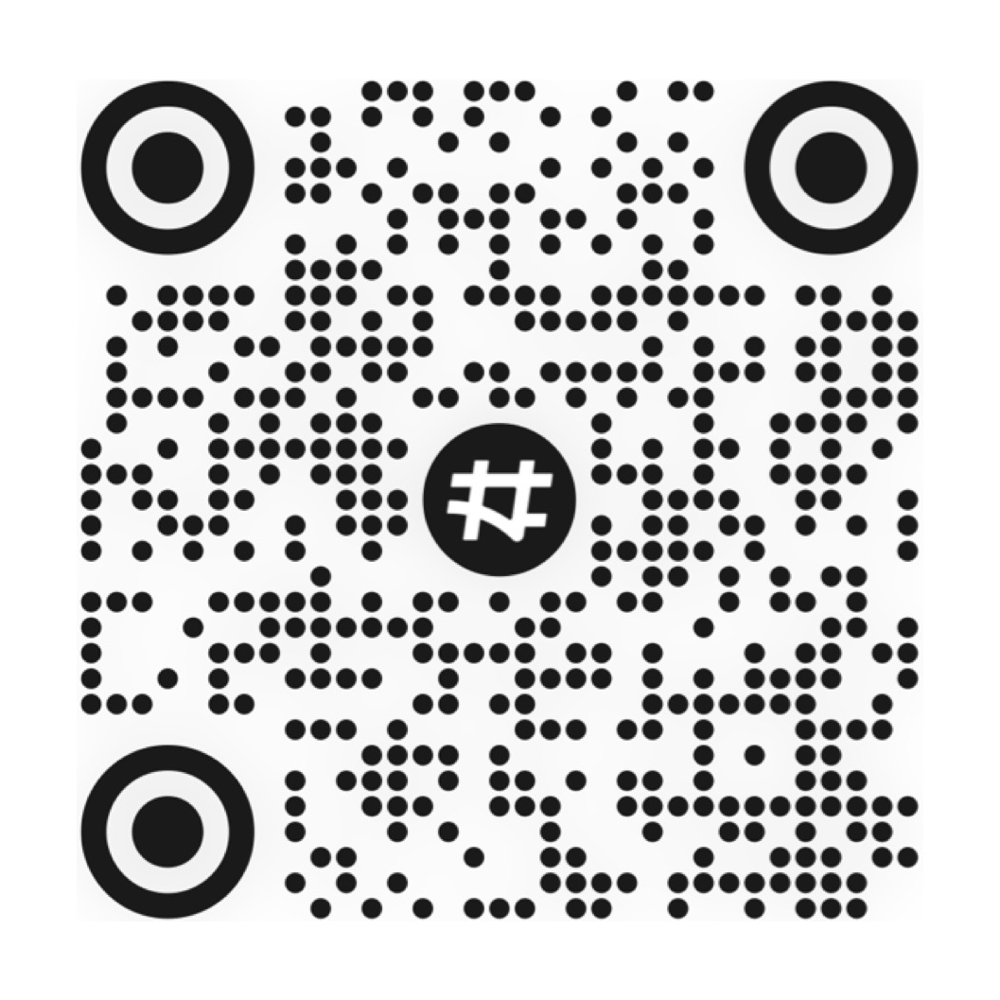

# 用量监控 macOS 独立应用

用量监控是独立的 macOS 桌面应用，不需要启动 DeepSeek Harness Desktop。

## 功能

- 查看 ChatGPT 当前 5 小时与每周窗口的剩余用量。
- 查看 Kimi 会员共享月额度；Kimi Code 的 5 小时和周额度单独显示（仅当接口提供时）。
- 可设置 ChatGPT 剩余用量报警阈值；任一窗口低于或等于阈值时，主界面和 HUD 中对应的数字与进度条变为橙色。
- 可设置 Kimi 会员月额度报警阈值；剩余比例低于或等于阈值时，主界面数字与进度条、HUD 月额度数字变为橙色。
- 可在设置中启用或关闭每 30 秒自动刷新；关闭后仍可手动刷新，开关状态保存在本机。
- 可设置 DeepSeek 余额报警币种和金额阈值；所选币种余额低于或等于阈值时，主界面与 HUD 中余额变为橙色。
- 可在设置中分别启用或停用 ChatGPT、DeepSeek、Kimi；三个工具默认全部停用。停用后会隐藏该工具的页面和相关信息，并停止其本机数据读取与网络请求。
- 启动时检测 ChatGPT 用量来源与 DeepSeek Harness 的本机安装或配置；设置为启用但未检测到数据源的工具会显示状态提示，不会启动数据读取或请求。
- 复用本机 DeepSeek Harness 凭据读取账户余额和官方累计消费金额；不在用量监控中保存额外账户凭据。
- 汇总本机 DeepSeek Harness 会话投影里的 Token 统计；此项来自本机记录，不是官方账单。
- 概览按模型并列显示剩余用量和 Token 统计；ChatGPT 与 DeepSeek 显示最近 200 个本机会话的输入、缓存输入、输出和合计。
- 可从概览卡片或详情页直接打开 ChatGPT 与 DeepSeek Harness 桌面应用。
- Kimi 会员额度接口不提供分项 Token 数据；Kimi 行会明确显示当前无法取得 Token 明细，不用额度比例估算 Token。
- 显示可拖动、可展开和收起的系统级悬浮窗，可拖到屏幕内任意位置，并可在设置中切换到任一已连接显示器。展开时以折叠胶囊左上角为锚点，折叠后回到同一位置。
- 可在主窗口顶栏独立开启菜单栏用量显示；左键单击刷新、双击打开主窗口、右键展开与悬浮窗 HUD 共用界面的用量卡片。各工具卡片仍由菜单栏 HUD 显示开关控制；此开关不影响原有悬浮窗。
- 主界面、HUD、窗口设置均由本机应用管理，不依赖 DSH 插件页运行。

## 构建与启动

需要 macOS 13 或更高版本，以及 Xcode。

```bash
open AAAAAUsage.xcodeproj
```

在 Xcode 中选择 `用量监控` scheme 后即可运行或构建。也可以执行 `./build-app.sh`，由 `xcodebuild` 构建并将应用放到 `build/用量监控.app`。本地构建使用 ad hoc 签名；公开分发前，需要用开发者证书签名并完成 Apple 公证。

安装 Release 版本时，从 GitHub Releases 下载 `.dmg`，打开后将“用量监控”拖入“应用程序”文件夹。本次安装包使用本机 ad hoc 签名，尚未进行 Apple 公证；macOS 可能提示无法验证开发者。正式公开分发需要开发者证书签名并完成公证。

## 反馈与赞助

遇到额度显示异常、功能故障，或希望支持新的模型，欢迎使用 QQ 扫描下方二维码加入腾讯频道。频道号：`pd93266932`。反馈能帮助我更快定位问题、安排更新；我会认真查看建议，并尽量同步处理进度。

用量监控由我独立开发和维护。如果它帮你省下了查用量的时间，欢迎自愿请我喝杯咖啡。赞助将用于后续适配、问题修复和功能改进；是否赞助不会影响任何功能。可使用微信支付或支付宝扫码：

<table>
  <thead>
    <tr>
      <th align="center">反馈与建议 · 腾讯频道</th>
      <th align="center">赞助 · 微信支付</th>
      <th align="center">赞助 · 支付宝</th>
    </tr>
  </thead>
  <tbody>
    <tr>
      <td align="center"></td>
      <td align="center"></td>
      <td align="center"></td>
    </tr>
    <tr>
      <td align="center">使用 QQ 扫码加入腾讯频道<br>频道号：<code>pd93266932</code></td>
      <td align="center">使用微信扫一扫，支持后续开发与维护</td>
      <td align="center">使用支付宝扫一扫，支持后续开发与维护</td>
    </tr>
  </tbody>
</table>

## 数据与隐私

- ChatGPT：复用 `~/.codex/auth.json` 中的本机访问令牌，只请求 `chatgpt.com/backend-api/wham/usage`；接口不可用时读取最近的 ChatGPT 本地会话快照。
- DeepSeek：复用 `~/.dsh/.credentials.yaml` 中的 DeepSeek Harness 凭据；账户请求只发往 `platform.deepseek.com`。用量监控不会另行保存账户凭据。
- Kimi：直接读取 Kimi 桌面端本机会话并查询会员额度，不另存或续期凭据；会话过期时由 Kimi 桌面端自行续期后再刷新。会员接口不可用时，尝试读取 Kimi Code 用量。
- 启动检测将 ChatGPT 用量的配置/会话目录、`ChatGPT.app`、`Codex.app` 或 `codex` 命令视为可用迹象；将 `~/.dsh`、`DeepSeek Harness.app` 或 `dsh` 命令视为 DeepSeek Harness 可用迹象。工具启用状态分别保存在本机；未启用的工具不会读取数据或发起请求。可在应用关闭后重新安装或移除相关桌面工具，再启动应用更新检测状态。
- DeepSeek 余额和累计消费金额都来自官方账户摘要接口。若官方接口不可用或返回格式变化，页面显示不可用，不以本地估算冒充官方金额。
- ChatGPT Token 统计从 `~/.codex/sessions` 最近 200 个本机会话日志中提取最终累计 Token 计数；DeepSeek 从 `~/.dsh/storages/session_projcache/sessions` 最近 200 条会话投影读取计数。只显示输入、缓存输入、输出和合计，不保存或上传会话正文。
- Kimi 会员额度接口与 Kimi Code 用量接口不提供本应用所需的分项 Token 计数，因此显示为不可用；不会把会员额度比例换算成 Token 数量。
- 工具启用状态、悬浮窗的开关、折叠状态、显示器、屏幕内相对位置、用量报警阈值和余额报警设置保存在本机应用偏好设置中。
- Kimi 会话由 Kimi 桌面端管理；用量监控只读 Kimi 桌面端的本地会话，凭据只发送到 Kimi 接口，不创建自己的令牌副本。Kimi 桌面端退出登录或会话过期时，由 Kimi 桌面端负责登录状态与续期。

DeepSeek 官方账户数据读取参考 [DeepSeek Harness 官方账户平台实现](https://github.com/deepseek-ai/deepseek-harness/tree/master/packages/credentials/deepseek-account-platform)。累计消费金额接口是开放平台页面使用的账户摘要接口，目前没有公开的稳定 API 文档。
